# Phu Quoc: Major Attractions Guide

Figures pulled on **15 October 2026**.

## Read this first: how good is the data?

I could not open Google Maps directly. So the star ratings below come from **Wanderlog**. That is a trip-planning site that copies the Google Maps rating and review count for each place. The numbers are real Google numbers, but they are a snapshot. Review counts move every day, and the same place sometimes shows a slightly different count on different pages. Treat every number as "about right".

**Photos.** I added a photo column to the master tables. Photos are free-licensed pictures from Wikimedia Commons, and I could not use Google's own photos because they are copyrighted. Click a small photo to see it larger. Credits are at the end of this file. Where no free photo exists, the row has a "find photos" link that opens that place on Google Maps.

Some things I could **not** find, and I say so in the tables instead of guessing:

- Google ratings for **Sunset Town / Kiss Bridge** (I show a third-party rating instead, clearly marked).
- Google ratings for **Aquatopia water park** and **Sun World Hon Thom Nature Park** (I show Trip.com ratings, clearly marked).

The "review analysis" is not a count of every review. I did not read thousands of reviews one by one. It comes from three things:

1. the star ratings and star breakdowns,
2. the review summaries that Wanderlog writes from Google reviews, and
3. travel guides and blogs.

Where I only have a rating and no review text, I say "review text not captured".

---

## The island in plain English

Phu Quoc is a large island. Its land area is about 590 km². It is not one "town with a beach". It has **clusters** of things far apart from each other. The big travel mistake is to pick a hotel in one area and then plan a day in another.

| Area | Where it is | What is there |
|---|---|---|
| **North / north-west** | Bai Dai and Ganh Dau coast | The big Vin parks (VinWonders, Safari), Grand World, the national park, Starfish Beach |
| **West / central-west** | Duong Dong town and Long Beach | The main town, Dinh Cau, the night market, sunset bars, the airport, pearl and fish-sauce visits |
| **East / inland** | Ham Ninh, hills, waterfall | Fishing village, Suoi Tranh waterfall, pepper farms, Ho Quoc Pagoda |
| **South / south-west / south-east** | An Thoi, Sao and Khem beaches | The cable car, Sunset Town and Kiss Bridge, the prison museum, the best-known beaches, the boat tours to small islands |

How far apart are they? One reviewer on Wanderlog said the Vinpearl resort is in the north, but many activities are in the south, "about an hour's trip" away. Sunset Town is about 40–45 minutes from Duong Dong and about 19–20 km from the airport.

A small naming note: some Google listings say "Kien Giang" and newer ones say "An Giang". Phu Quoc was moved into An Giang province after provincial mergers. It is the same island.

---

## Master list (quick view)

Ratings are Google, out of 5, with the number of reviews in brackets. "n/c" means not captured.

### North / north-west

| # | Attraction | Direction | Google rating (reviews) | Quick take | Photo |
|---|---|---|---|---|---|
| 1 | **VinWonders Phu Quoc** (theme park + water park) | North-west (Bai Dai) | **4.8** (17,816) | Top-rated big attraction on the island |  |
| 2 | **Vinpearl Safari** (open zoo) | North-west | **4.6** (about 26,650) | Huge. Best for families and giraffe feeding | [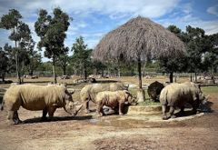](images/phu-quoc/vinpearl-safari.jpg) |
| 3 | **Grand World** (canals, shops, night shows) | North-west (Bai Dai / Ganh Dau) | **4.4** (12,620) | Evening place. Photogenic, built for visitors |  |
| 4 | **Phu Quoc National Park** | North / centre | **4.2** (1,074) | Nature and hiking. Check it is open (see notes) | [find photos](https://www.google.com/maps/search/?api=1&query=Phu+Quoc+National+Park+Phu+Quoc) |
| 5 | **Starfish Beach (Rach Vem)** | North | **3.8** (3,636) | Starfish are the point. Shallow, not for swimming | [find photos](https://www.google.com/maps/search/?api=1&query=Starfish+Beach+Phu+Quoc) |
| 6 | **Ganh Dau beach** | Far north-west tip | **4.2** (274) | Northern coast, near the national park | [find photos](https://www.google.com/maps/search/?api=1&query=Ganh+Dau+beach+Phu+Quoc) |
| 7 | **Bai Dai Beach** | North-west | **4.2** (512) | Long beach (about 15 km) near the big parks | [find photos](https://www.google.com/maps/search/?api=1&query=Bai+Dai+Beach+Phu+Quoc) |
| 8 | **Vung Bau Beach** | North-west | **3.8** (about 200) | Calm bay, kayaking, rock formations | [find photos](https://www.google.com/maps/search/?api=1&query=Vung+Bau+Beach+Phu+Quoc) |
| 9 | **Cua Can Beach** | North-west | **3.8** (290) | Fewer reviews, so a weaker signal | [find photos](https://www.google.com/maps/search/?api=1&query=Cua+Can+Beach+Phu+Quoc) |

### West / central-west (Duong Dong and Long Beach)

| # | Attraction | Direction | Google rating (reviews) | Quick take | Photo |
|---|---|---|---|---|---|
| 10 | **Dinh Cau** (sea-goddess shrine + small lighthouse) | West (Duong Dong harbour) | **4.5** (3,675) | Small, easy, good at sunset | [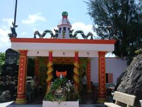](images/phu-quoc/dinh-cau.jpg) |
| 11 | **Phu Quoc Night Market** (main listing) | West (Duong Dong, Bach Dang St) | **4.0** (6,575) | Great for seafood and snacks, but touristy | [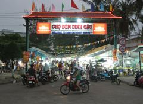](images/phu-quoc/night-market.jpg) |
| 12 | **Long Beach (Bai Truong)** | West / south-west of the town | **4.4** (765) | About 20 km long. Busy, built-up, easy swim |  |
| 13 | **Ong Lang Beach** | West, about 6–7 km from the town | **3.8** (474) (a second listing shows **4.1** (745)) | Sunsets, bars, chairs | [find photos](https://www.google.com/maps/search/?api=1&query=Ong+Lang+Beach+Phu+Quoc) |
| 14 | **Sunset Sanato Beach Club** | West | **4.0** (2,666) | Sunset drinks. A very common stop | [find photos](https://www.google.com/maps/search/?api=1&query=Sunset+Sanato+Beach+Club+Phu+Quoc) |
| 15 | **Ngoc Hien Pearl Farm** | West, near Long Beach | **4.2** (3,754) | Pearl demo and shop | [find photos](https://www.google.com/maps/search/?api=1&query=Ngoc+Hien+Pearl+Farm+Phu+Quoc) |
| 16 | **Huynh Khoa fish-sauce showroom** | West, Duong Dong | **4.9** (372) | Local product visit | [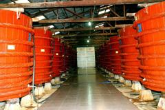](images/phu-quoc/fish-sauce.jpg) |
| 17 | **Su Muon Pagoda** | Duong Dong, hilltop | **4.4** (608) | Hilltop pagoda, reached by about 60 stone steps | [find photos](https://www.google.com/maps/search/?api=1&query=Su+Muon+Pagoda+Phu+Quoc) |

### East / inland

| # | Attraction | Direction | Google rating (reviews) | Quick take | Photo |
|---|---|---|---|---|---|
| 18 | **Ho Quoc Pagoda** | East coast hillside (Duong To area), about 18–25 km from Duong Dong | **4.7** (1,424) | Big Zen monastery with sea views | [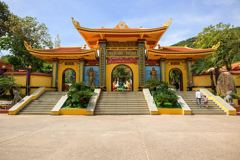](images/phu-quoc/ho-quoc-pagoda.jpg) |
| 19 | **Suoi Tranh Waterfall** | Inland, about 7 km from Duong Dong | **4.0** (about 587) | Short jungle walk to a waterfall | [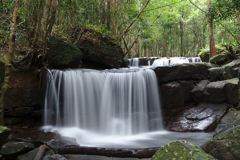](images/phu-quoc/suoi-tranh.jpg) |
| 20 | **Ham Ninh fishing village** | East | **4.1** (1,045) | Seafood restaurants on stilts and piers | [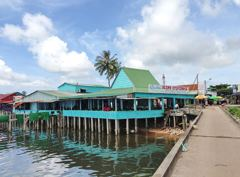](images/phu-quoc/ham-ninh.jpg) |
| 21 | **Pepper Farm (Phu Quoc Countryside)** | Inland | **4.8** (801) | Small farm visit. High rating | [find photos](https://www.google.com/maps/search/?api=1&query=Pepper+Farm+Phu+Quoc) |
| 22 | **Suoi Da Ban** (stream and eco area) | Inland | **4.1** (507) | Jungle eco area with swimming pools | [find photos](https://www.google.com/maps/search/?api=1&query=Suoi+Da+Ban+Phu+Quoc) |

### South / south-west / south-east

| # | Attraction | Direction | Google rating (reviews) | Quick take | Photo |
|---|---|---|---|---|---|
| 23 | **Sun World Hon Thom cable car** | South (An Thoi station) | **4.5** (about 19,410) | Very long over-sea cable car. Ticket includes the island park | [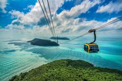](images/phu-quoc/cable-car.jpg) |
| 24 | **Sun World Hon Thom Nature Park + Aquatopia water park** | Hon Thom island (off the south tip) | Google n/c. Trip.com: 4.7 (about 215) | Water park and rides on the island | [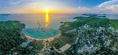](images/phu-quoc/hon-thom-park.jpg) [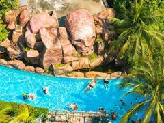](images/phu-quoc/aquatopia.jpg) |
| 25 | **Sunset Town and Kiss Bridge** | South-west (An Thoi) | Google n/c. Airial: 4.7 (about 1,900) | Evening photos, show around sunset and later |  |
| 26 | **Phu Quoc Prison (Coconut Tree Prison)** | South (An Thoi) | **4.3** (about 9,420) | Serious war museum. Many reviews |  |
| 27 | **Sao Beach** | South-east | **3.9** (about 8,200) | The famous white-sand beach, with problems | [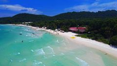](images/phu-quoc/sao-beach.jpg) |
| 28 | **Khem Beach** | South / south-east | **4.4** (2,109) | Often called cleaner and quieter than Sao | [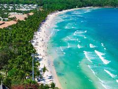](images/phu-quoc/khem-beach.jpg) |
| 29 | **An Thoi Archipelago boat tours** | Off the southern tip | Hon Mong Tay **4.5** (96) | Snorkelling and island hopping. Few reviews, so low confidence | [find photos](https://www.google.com/maps/search/?api=1&query=An+Thoi+Archipelago+Phu+Quoc) |

**Whole island on Google:** Phu Quoc as a place is **4.4** (about 6,000).

---

## Review analysis, area by area

### North / north-west

**VinWonders (4.8, 17,816).**
- *Likes:* Wanderlog's summary of Google reviews says visitors found it **not crowded**, with **short queues** and quick entry. They praise the **water park**, the **Adventure World** zone, and the **food**. Another source says the Sea Shell **aquarium** is a highlight and that there are **indoor areas** that give relief from the heat.
- *Dislikes:* Some **ride closures**, and some reviewers found **water-park staff very strict**.
- *Facts:* About 50 hectares with six themed zones. Open daily 10:00–19:30 (from the official site). It used to be called VinpearlLand.
- *Verdict:* The best-rated large paid attraction on the island. On Trip.com it scores a bit lower (4.5–4.6), so Google reviewers are a little more generous.

**Vinpearl Safari (4.6, about 26,650).**
- *Likes:* Reviews and guides stress that it is **huge**, with **giraffe feeding** and animal shows. A 2026 review says kids love it and you should **start early** to see everything.
- *Dislikes:* I found no clear complaint text. The main practical warning is the **size and the heat**, so plan your day around that. (Review text on complaints not captured.)
- *Verdict:* Very safe choice for families.

**Grand World (4.4, 12,620).**
- *Likes:* Known for its **canals ("Little Venice"), cafes, shops and nightly shows**. It is described as best **after sunset**. Trip.com users also like the **night view**.
- *Dislikes:* Review text not captured. The lower score than the two parks above (4.4 vs 4.6–4.8) suggests more mixed feelings, but I cannot say why from the data.
- *Verdict:* An evening walk and photo stop. Do not plan a full day here.

**Phu Quoc National Park (4.2, 1,074).**
- Described as a **UNESCO Biosphere Reserve** (a nature area that the UN recognises for protecting both wildlife and local people). Good for hiking.
- One snapshot of the Wanderlog page showed it as "permanently closed". I could not confirm what that means. **Check Google Maps for opening status before you go.**

**Starfish Beach / Rach Vem (3.8, 3,636).**
- *Likes:* Red starfish in clear shallow water, a calm setting, and seafood nearby.
- *Dislikes:* The water is **shallow and not good for swimming**. Reviewers saw **dead starfish** caused by tourists lifting them out of the water. The road is **bumpy**. Some reviewers call it a **tourist trap with inflated prices**. Boat-ride offers are often unnecessary. Best at **low tide** (when the water is at its lowest and starfish are easiest to see).
- *Tip:* Look, do not lift the starfish out of the water. Taking them out of the water kills them.
- *Verdict:* A "look and go" stop. The rating (3.8) fits that.

**North and north-west beaches (Ganh Dau 4.2, Bai Dai 4.2, Vung Bau 3.8, Cua Can 3.8).**
- Review counts are small (about 140–510), so the ratings are less solid. One reader comment on a travel blog said northern beaches are **cleaner and have fewer tourists**. That is one person's view, not proof.

### West / central-west (Duong Dong, Long Beach)

**Dinh Cau (4.5, 3,675).**
- A small shrine to the **sea goddess** with a **blue-and-white striped lighthouse** and harbour views. It is a short, easy stop. Reviews are consistently kind. Another small temple near it (Dinh Ba Thuy Long Thanh Mau) scores 4.5 (282).

**Phu Quoc Night Market (4.0, 6,575).**
- *Likes:* Lively. Good **street food, snacks and seafood**. Friendly shopkeepers.
- *Dislikes:* **Touristy and pricey**, especially souvenirs and some food. Reviewers warn about **scams** such as bait-and-switch sales and fake goods. Guides advise **cooked seafood only** unless you know what you are buying, and to **check the price before you order**.
- *Details:* Sources disagree on hours. One says about 17:00 to midnight. Another (older) says it closes around 23:00, with the busiest time 19:00–22:00.
- *Note:* Google has **several listings** for the market. The smaller ones score 3.8–3.9 (about 440–480 reviews). The main one is 4.0.
- *Verdict:* Go for the atmosphere and the food. Agree on prices first.

**Long Beach (4.4, 765).**
- Very long and the easiest beach to reach from the town. One travel blogger found it **crowded and built-up**, "convenient for a quick swim" but unremarkable.

**Ong Lang Beach (3.8 on one listing, 4.1 on another).**
- Swimming, sunbathing, bars and chairs. Known for **sunsets**.

**Sunset Sanato (4.0, 2,666).**
- A beach club for sunset drinks. A nearby bar and restaurant listing scores 4.3 (2,229).

**Ngoc Hien Pearl Farm (4.2, 3,754) and fish-sauce showroom (4.9, 372).**
- Review text not captured. In my reading, these are **demonstration plus shop** stops, so expect a sales pitch. This is my interpretation, not a quote from reviews. Phu Quoc is famous for **fish sauce (nuoc mam)** and **pepper**, so tours often bundle a pepper farm, a pearl farm and a fish-sauce factory.

### East / inland

**Ho Quoc Pagoda (4.7, 1,424).**
- One of the best-rated sights in the east. Known as a **sea-view Zen monastery** on a hillside. Review text not captured. Dress modestly for any temple.

**Suoi Tranh Waterfall (4.0, 587).**
- Called the most popular and easiest-to-reach waterfall on the island. From general travel knowledge (not from the review pull): the flow is strongest in the **wet season**, and it can be thin in the dry months. Check recent photos before you go.

**Ham Ninh fishing village (4.1, 1,045).**
- A traditional village with seafood places. One nearby seafood restaurant scores 4.7 (1,383).

**Pepper Farm (4.8, 801).**
- Small, so a high rating. The bigger tour combos often include it.

### South

**Hon Thom cable car (4.5, about 19,410).**
- *Likes:* Views over the sea and the An Thoi islands from about 150 m up. About 8 km of cable, billed as one of the longest over-sea cable cars in the world (the Guinness record claim comes from promotional sources).
- *Dislikes:* The **return trip can be crowded and chaotic**. One blogger said the beach areas on Hon Thom were **restricted by guards**, and had mixed feelings about the environmental impact (this was a 2019 visit, so check what has changed). The Hon Thom beach listing "Pineapple beach" scores only **2.9** (51 reviews), so do not go for the beach.
- *Tickets:* One source says the cable car is **not sold alone**. You are buying a Sun World Hon Thom ticket, and the round trip includes **Aquatopia water park**. Prices were not given in the sources I read. Check the official Sun World site.
- *Hours:* One guide says it runs in two windows, about **09:00–11:30 and 13:30–17:00**, with a midday break. Confirm this before you go.

**Sunset Town and Kiss Bridge (Google n/c; Airial 4.7).**
- A seaside Mediterranean-style town with a two-branch bridge into the sea. Best around sunset. There is an evening **"Kiss of the Sea" show** (water, light and projection). One guide suggests arriving around **15:00–16:00** and watching shows from about **19:00**.
- *Costs (from one source, confirm):* about 100,000 VND per adult from 07:00–16:00 and 200,000 VND from 16:00–20:00. Book evening show tickets early at peak times.
- A Klook tour that combined Sunset Town, Kiss Bridge and a night market scored 4.2 (26 reviews). Reviewers liked the guide and photo stops. One was unhappy that dinner was only noodles. That is a tour review, not a rating of the place.

**Phu Quoc Prison / Coconut Tree Prison (4.3, about 9,420).**
- This one has a full star breakdown from the Wanderlog page (9,412 reviews):

| Stars | Reviews | Share |
|---|---|---|
| 5 | 5,449 | 58% |
| 4 | 2,110 | 22% |
| 3 | 1,214 | 13% |
| 2 | 289 | 3% |
| 1 | 350 | 4% |

- *Likes:* "Deeply moving and thought-provoking." Detailed reconstructions, photos and stories. Translated signs. A tribute to Vietnamese resilience.
- *Dislikes:* The page gave no reasons for the 639 one- and two-star reviews. Blogs say the site has been **heavily rebuilt**, so very little looks original, and the content is **graphic** (reconstructed cells and "tiger cages"). It is also **sunny and hot**, so bring an umbrella or cap and water.
- *Verdict:* A strong history stop. Not for small children or anyone who wants a light day.

**Sao Beach (3.9, about 8,200; Tripadvisor 3.4 from 4,216).**
- *Likes:* **White sand, clear water**, sun beds and water activities. Some call it a quieter option than busier beaches.
- *Dislikes:* **Litter and pollution** is the main complaint. One Google reviewer said there was "an enormous amount of ocean trash everywhere" and left for Khem Beach. Beach clubs only clean their own patch. **Jet-ski noise.** **Sun beds cost about 100,000–150,000 VND**, even if you buy a drink. You may have to pay for toilets and showers.
- *Verdict:* The photos are better than the reality. Go early, bring a towel, and consider Khem Beach instead. The big gap between the 5-star and 1-star counts on Tripadvisor (3,650 vs 741) shows how divided people are.

**Khem Beach (4.4, 2,109).**
- One guide says it is "probably the quietest" beach on the island. A Sao Beach reviewer switched to it because it was cleaner. Good score on a decent number of reviews.

**An Thoi Archipelago boat tours.**
- Snorkelling and island hopping. Google counts for islands are tiny (Hon Mong Tay 4.5 from 96). One blogger found snorkelling here unremarkable compared with Con Dao (another Vietnamese island group). Treat this as optional. Tour quality depends on the operator.

---

## What the ratings tell you overall

- **Managed, paid places score highest.** VinWonders 4.8, Safari 4.6, cable car 4.5, Dinh Cau 4.5, Ho Quoc Pagoda 4.7. These are controlled places with staff, clear entry, and no litter problem.
- **Open beaches and the market score lowest (3.8–4.0)**, apart from Khem and Long Beach. The reasons in the reviews are **litter**, **crowds**, **touts and prices**.
- **A beach rating of 3.8–3.9 does not mean "bad".** It means "good scenery, with real problems". Sao Beach has over 8,000 reviews, so its score is solid and not a fluke.
- **Small review counts are weak evidence.** Anything under about 200 reviews (Hon Mong Tay 96, Vung Bau about 200) could move a lot with a few more reviews.
- **Platforms differ.** Google tends to be a little kinder than Trip.com or Tripadvisor (for example, Sao Beach is 3.9 on Google and 3.4 on Tripadvisor).

---

## Major things to understand before you go

1. **Season matters right now.** The dry season is roughly **November to April**. The wet season is roughly **May to October**, with the wettest stretch usually June–September. Mid-October is a **transition month**, so expect some rain and a rougher sea. Sources agree that boat and outdoor plans are **less predictable in the wet season**. None of them gave cancellation rates, so ask your tour operator about the weather policy.
2. **Plan by area, not by list.** North (parks, Grand World) and south (cable car, Sunset Town, prison, Sao Beach) are about an hour apart. Try to do one cluster per day.
3. **The cable car and show timings are strict.** The cable car has a midday break (one guide says about 2 hours). Evening shows start around 19:00. Arriving at the wrong time can mean a long wait.
4. **Ticket prices (operator figures, may be out of date).** VinWonders 950,000 VND, Vinpearl Safari 850,000 VND, and a combo about 1,500,000 VND for guests 1.4 m and taller. A free Vinpearl bus is said to run between Duong Dong, the Safari and VinWonders from 08:00 to 20:00. 1,000,000 VND is very roughly 40 USD, but check today's rate. Always check the official site before paying a reseller.
5. **Visa.** Travel-agency and tourism-site guides say visitors can stay **up to 30 days without a visa** on Phu Quoc if they fly **directly** to the island. This covers the island only and does not give free access to the Vietnamese mainland. These are not government sources. **Confirm with the official Vietnamese immigration or embassy pages before you book.** See the [Vietnam tourism visa explainer](https://www.vietnamtourism.com/en/phu-quoc-visa-free-entry-how-the-30-day-exemption-works-and-who-qualifies).
6. **Beaches: expect rubbish at some, and some are blocked.** Litter is the top complaint at Sao Beach. A 2019 blogger also found some beaches closed off by resorts, with guards turning people away. That was a few years ago, so check locally.
7. **Money and scams.** Several sources warn about higher prices at the night market and tourist spots, bait-and-switch sales and counterfeit goods. Agree the price first, for food, rides and sun beds.
8. **Heat.** Daytime temperatures are around 30–33 °C, and one blogger found riding a scooter at midday (about 35 °C) exhausting. Plan outdoor sights early or late.
9. **Respect the animals.** Do not pull starfish out of the water at Rach Vem. Reviewers say tourists are killing them.
10. **Dress for temples and the prison.** Cover shoulders and knees at pagodas. The prison is graphic and hot.
11. **Data quirks to keep in mind.** Some Google listings are mislabelled (for example, one "Tiem Nuong Xom Leo" entry showed reviews about a lake in Dalat, so I left it out). The national park showed as "permanently closed" on one snapshot. A few places have several Google listings (the night market has at least three). Always check the live Google Maps pin.

---

## What I could not confirm (so you know)

- Google rating and review count for **Sunset Town / Kiss Bridge**, **Aquatopia**, and **Sun World Hon Thom Nature Park**.
- Detailed Google review text for **Grand World**, **Ho Quoc Pagoda**, **Pearl farm** and **Suoi Tranh**.
- Real queue lengths at the cable car and parks.
- Whether the national park is open.
- Current ticket prices. The numbers above are from operator and blog pages.

If you want, the next step is to fill these gaps by checking each place's Google Maps page when you are on a normal browser.

---

## Photo credits

All photos come from [Wikimedia Commons](https://commons.wikimedia.org/) under the free licences shown. I resized each one (800 px wide, plus a small thumbnail). I did not change them in any other way. CC BY-SA licences ask you to credit the photographer and keep the same licence if you share them.

| Place | Photo and photographer | Licence |
|---|---|---|
| VinWonders | [VinWonders Phu Quoc from ferris wheel.jpg](https://commons.wikimedia.org/wiki/File:VinWonders_Phu_Quoc_from_ferris_wheel.jpg) by lol1VNIO | [CC BY-SA 4.0](https://creativecommons.org/licenses/by-sa/4.0/) |
| Vinpearl Safari | [The Herd of Rhinos.jpg](https://commons.wikimedia.org/wiki/File:The_Herd_of_Rhinos.jpg) by Aidashhk | [CC0](https://creativecommons.org/publicdomain/zero/1.0/) |
| Grand World | [2023-07-30 Grand World Phú Quốc DSCF2045.jpg](https://commons.wikimedia.org/wiki/File:2023-07-30_Grand_World_Ph%C3%BA_Qu%E1%BB%91c_DSCF2045.jpg) by 松岡明芳 | [CC BY-SA 4.0](https://creativecommons.org/licenses/by-sa/4.0/) |
| Dinh Cau | [Dinh Cậu Phú Quốc.jpg](https://commons.wikimedia.org/wiki/File:Dinh_C%E1%BA%ADu_Ph%C3%BA_Qu%E1%BB%91c.jpg) by Hoangvantoanajc | [CC BY-SA 3.0](https://creativecommons.org/licenses/by-sa/3.0/) |
| Phu Quoc Night Market | [Night market in Phu Quoc.jpg](https://commons.wikimedia.org/wiki/File:Night_market_in_Phu_Quoc.jpg) by Tonbi ko | [CC BY-SA 4.0](https://creativecommons.org/licenses/by-sa/4.0/) |
| Long Beach | [Sunset on the Long Beach in Phu Quoc Island, Vietnam, 5 March 2019.jpg](https://commons.wikimedia.org/wiki/File:Sunset_on_the_Long_Beach_in_Phu_Quoc_Island,_Vietnam,_5_March_2019.jpg) by Alexey Komarov | [CC BY-SA 4.0](https://creativecommons.org/licenses/by-sa/4.0/) |
| Fish-sauce factory | [Vats at a Fish Sauce Factory on Phu Quoc Island in Vietnam 01.jpg](https://commons.wikimedia.org/wiki/File:Vats_at_a_Fish_Sauce_Factory_on_Phu_Quoc_Island_in_Vietnam_01.jpg) by Frank Fox | [CC BY-SA 4.0](https://creativecommons.org/licenses/by-sa/4.0/) |
| Ho Quoc Pagoda | [Chùa Hộ Quốc (52681168609).jpg](https://commons.wikimedia.org/wiki/File:Ch%C3%B9a_H%E1%BB%99_Qu%E1%BB%91c_(52681168609).jpg) by Kevin Rutherford from United States | [CC BY-SA 2.0](https://creativecommons.org/licenses/by-sa/2.0/) |
| Suoi Tranh Waterfall | [Suối Tranh Phú Quốc (37111056503).jpg](https://commons.wikimedia.org/wiki/File:Su%E1%BB%91i_Tranh_Ph%C3%BA_Qu%E1%BB%91c_(37111056503).jpg) by Sketyl none | [CC BY 2.0](https://creativecommons.org/licenses/by/2.0/) |
| Ham Ninh fishing village | [Hàm Ninh, Nhà hàng hải Sản,Phú Quốc, Vietnam - panoramio.jpg](https://commons.wikimedia.org/wiki/File:H%C3%A0m_Ninh,_Nh%C3%A0_h%C3%A0ng_h%E1%BA%A3i_S%E1%BA%A3n,Ph%C3%BA_Qu%E1%BB%91c,_Vietnam_-_panoramio.jpg) by trungydang | [CC BY 3.0](https://creativecommons.org/licenses/by/3.0/) |
| Hon Thom cable car | [Hon Thom Cable Car aerial view Phu Quoc Island Vietnam.jpg](https://commons.wikimedia.org/wiki/File:Hon_Thom_Cable_Car_aerial_view_Phu_Quoc_Island_Vietnam.jpg) by Vivu Vietnam | [CC BY-SA 4.0](https://creativecommons.org/licenses/by-sa/4.0/) |
| Sun World Hon Thom Nature Park | [Sun World Hon Thom aerial view panorama sunset Phu Quoc.jpg](https://commons.wikimedia.org/wiki/File:Sun_World_Hon_Thom_aerial_view_panorama_sunset_Phu_Quoc.jpg) by Vivu Vietnam | [CC BY-SA 4.0](https://creativecommons.org/licenses/by-sa/4.0/) |
| Aquatopia water park | [Cong-vien-nuoc-aquatopia-5.jpg](https://commons.wikimedia.org/wiki/File:Cong-vien-nuoc-aquatopia-5.jpg) by Vivu Vietnam | [CC BY-SA 4.0](https://creativecommons.org/licenses/by-sa/4.0/) |
| Sunset Town and Kiss Bridge | [Kiss Bridge at sunset Phu Quoc Island Vietnam.jpg](https://commons.wikimedia.org/wiki/File:Kiss_Bridge_at_sunset_Phu_Quoc_Island_Vietnam.jpg) by Vivu Vietnam | [CC BY-SA 4.0](https://creativecommons.org/licenses/by-sa/4.0/) |
| Phu Quoc Prison | [Phu Quoc Prison.jpg](https://commons.wikimedia.org/wiki/File:Phu_Quoc_Prison.jpg) by Frank Fox | [CC BY-SA 4.0](https://creativecommons.org/licenses/by-sa/4.0/) |
| Sao Beach | [Bai-sao-phu-quoc-tuonglamphotos.jpg](https://commons.wikimedia.org/wiki/File:Bai-sao-phu-quoc-tuonglamphotos.jpg) by Trantuonglam | [CC BY-SA 4.0](https://creativecommons.org/licenses/by-sa/4.0/) |
| Khem Beach | [Bai-kem-dong-khach-1.jpg](https://commons.wikimedia.org/wiki/File:Bai-kem-dong-khach-1.jpg) by Vivu Vietnam | [CC BY-SA 4.0](https://creativecommons.org/licenses/by-sa/4.0/) |

**No free photo found** (use the "find photos" links in the tables): Phu Quoc National Park, Starfish Beach, Ganh Dau, Bai Dai, Vung Bau, Cua Can, Ong Lang, Sunset Sanato, Ngoc Hien Pearl Farm, Su Muon Pagoda, Pepper Farm, Suoi Da Ban, and the An Thoi boat tours.

---

## Sources

Ratings and review counts (Google data, shown on Wanderlog):
- [Wanderlog: best beaches in and around Phu Quoc](https://wanderlog.com/list/geoCategory/1498204/best-beaches-in-and-around-phu-quoc-island)
- [Wanderlog: Duong Dong things to do](https://wanderlog.com/list/geoCategory/1586781/top-things-to-do-and-attractions-in-duong-dong)
- [Wanderlog: Phu Quoc in November](https://wanderlog.com/geoInMonth/202/11/phu-quoc-island-in-november)
- [Wanderlog: Phu Quoc trip planner](https://wanderlog.com/tp/202/phu-quoc-island-trip-planner)
- [Wanderlog: Phu Quoc Prison History Museum](https://wanderlog.com/place/details/756754/phu-quoc-prison-history-museum)
- [Wanderlog: Sao Beach](https://wanderlog.com/place/details/30709/sao-beach)
- [Wanderlog: VinWonders Phu Quoc](https://wanderlog.com/place/details/2175961/vinwonders-phú-quốc)
- [Wanderlog: Starfish Beach](https://wanderlog.com/place/details/118316/starfish-beach)

Other ratings (not Google):
- [Trip.com: best things to do in Phu Quoc](https://sa.trip.com/toplist/tripbest/phu-quoc-island-best-things-to-do-100000015137)
- [Airial: Kiss of the Bridge](https://airial.travel/attractions/vietnam/phu-quoc/kiss-of-the-bridge-phu-quoc-RPl-oq8t)
- [Airial: Dinh Cau Night Market and Temple](https://airial.travel/attractions/vietnam/th%C3%A0nh-ph%E1%BB%91-ph%C3%BA-qu%E1%BB%91c/dinh-cau-night-market-dinh-cau-temple-phu-quoc-vietnam-2VD6GW1a)

Context, tips and warnings:
- [Visit Phu Quoc: Sunset Town review](https://visitphuquoc.com.vn/en/detailed-exploration-review-of-sunset-town-phu-quoc-from-a-to-z-9712)
- [Visit Phu Quoc: Hon Thom cable car tickets and tips](https://visitphuquoc.com.vn/en/whats-at-the-worlds-longest-hon-thom-cable-car-ticket-prices-and-tips-9831)
- [Visit Phu Quoc: Ho Quoc Pagoda](https://visitphuquoc.com.vn/en/ho-quoc-pagoda-a-serene-paradise-in-the-heart-of-pearl-island)
- [VinWonders: guide to visiting VinWonders and Vinpearl Safari](https://vinwonders.com/vi/wonderpedia/news/kinh-nghiem-di-vinwonders-va-vinpearl-safari-phu-quoc-chi-tiet/)
- [TRVLogue: VinWonders and Safari tickets](https://www.trvlogue.com/en/vinwonders-phu-quoc-tickets)
- [Local Vietnam: Phu Quoc Night Market guide](https://localvietnam.com/phu-quoc/phu-quoc-night-market/)
- [Local Vietnam: Starfish Beach guide](https://localvietnam.com/phu-quoc/starfish-beach-rach-vem-phu-quoc/)
- [Local Vietnam: best time to visit Phu Quoc](https://localvietnam.com/phu-quoc/best-time-to-visit-phu-quoc/)
- [Dave's Travel Pages: honest take on Phu Quoc](https://www.davestravelpages.com/lets-be-honest-about-phu-quoc-in-vietnam/) (a 2019 visit, so older)
- [Phu Quoc map (Vietnam Tourism)](https://www.vietnamtourism.com/en/maps/phu-quoc)
