# Phu Quoc: Final Guide to 13 Attractions

This guide covers 13 places:

- the **12 attractions with more than 2,000 Google reviews**, and
- **Sun World Hon Thom Nature Park + Aquatopia water park**, which you asked me to add.

Each place has its location, Google rating, how long to spend there, a review analysis, and the main things to know.

**Interactive map:** [Phu Quoc Attraction Map](https://claude.ai/artifact/3WgF73jGbT7Gk4SqWVNuWi). The link is private until the owner shares it. The same map is in this repo as `phu-quoc-map.html`.

## How to read the numbers

- **Ratings and review counts** are Google figures as copied by Wanderlog, a trip-planning site. I pulled them on 15 October 2026. Counts change every day, so treat them as "about right". I could not open Google Maps directly.
- **Hon Thom Nature Park + Aquatopia** has no Google count that I could find. Its 4.7 rating is from Trip.com (about 215 reviews).
- **Review analysis** comes from star breakdowns, Wanderlog's summaries of Google reviews, and travel guides. I did not read every review one by one.
- **Times marked †** are my own estimates. They come from map distances and typical visits, not from a source. Times without † come from the sources listed at the end. Where sources disagree, I say so.
- **Opening hours and prices change.** Check the official site or Google Maps before you go.

---

## Quick table

| # | Attraction | Area | Google rating (reviews) | Time to spend | Best time of day | Travel from Duong Dong town† |
|---|---|---|---|---|---|---|
| 1 | **Vinpearl Safari** | North-west | **4.6** (26,636) | About 3 hours | Morning. Last entry around 15:00 | 25–30 min (taxi or motorbike) |
| 2 | **Hon Thom cable car** (with Sun World Hon Thom) | South (An Thoi) | **4.5** (19,408) | The ride is short. The whole Sun World Hon Thom visit takes 6–8 hours | Morning start | About 45 min† |
| 3 | **VinWonders** | North-west | **4.8** (17,816) | 4–6 hours† (both Vin parks in one day is 8–10 hours) | Afternoon into evening | About 30 min† |
| 4 | **Grand World** | North-west | **4.4** (12,620) | 2–3 hours† | After sunset | About 30 min† |
| 5 | **Phu Quoc Prison** | South (An Thoi) | **4.3** (9,412) | 1–2 hours (some guides say 30–60 min) | Morning. Closed over midday | About 40 min† |
| 6 | **Sao Beach** | South-east | **3.9** (8,202) | 1–3 hours† | Early morning | About 25 min |
| 7 | **Phu Quoc Night Market** | West (Duong Dong) | **4.0** (6,575) | 1–2 hours | About 18:30–21:00 | In town |
| 8 | **Ngoc Hien Pearl Farm** | West, near Long Beach | **4.2** (3,754) | 30–60 min† | Any time in daylight | About 10–15 min† |
| 9 | **Dinh Cau** | West (Duong Dong harbour) | **4.5** (3,675) | 20–30 min† alone. Add it to the night market visit | Sunset | In town |
| 10 | **Starfish Beach (Rach Vem)** | North | **3.8** (3,636) | 45–90 min† | Low tide | About 45–60 min† |
| 11 | **Sunset Sanato** | West, Long Beach | **4.0** (2,666) | 1.5–2 hours† | Late afternoon to sunset | About 10–15 min† |
| 12 | **Khem Beach** | South | **4.4** (2,109) | 1–2 hours† | Morning | About 35–40 min† |
| 13 | **Sun World Hon Thom Nature Park + Aquatopia** | Hon Thom island (reached by cable car) | Trip.com **4.7** (about 215) | 4–6 hours† for the park and water park (inside the 6–8 hour Sun World day) | Morning start | About 45 min† to the cable car station |

---

## North-west and north

### 1. Vinpearl Safari

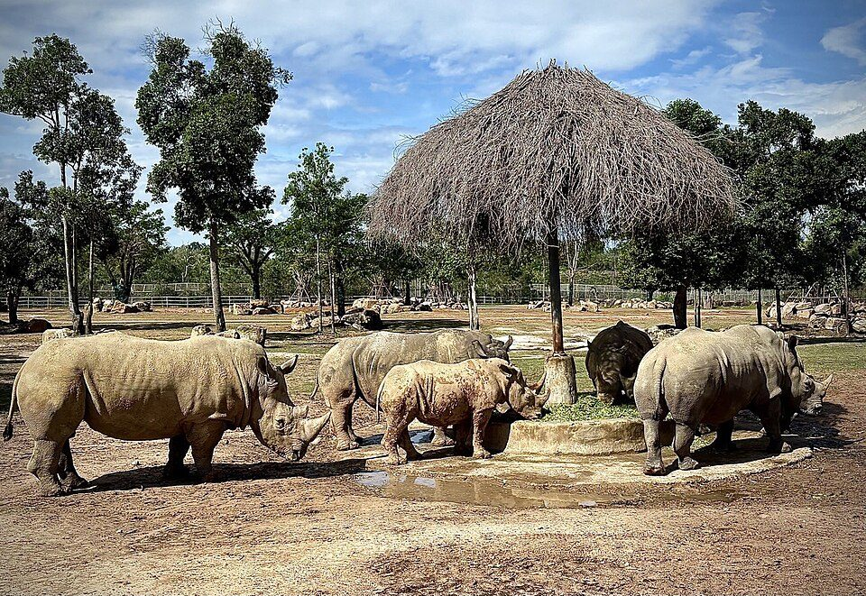

| | |
|---|---|
| **Where** | North-west, Bai Dai area |
| **Google rating** | **4.6** (26,636 reviews). The most-reviewed attraction in this guide. |
| **Time needed** | About 3 hours. One tour plan gives the safari a morning block of about 3 hours. |
| **Hours** | Roughly 08:30 or 09:00 to 16:00. One 2026 guide says the first safari bus leaves at 09:00, the last at 15:20, and the safari zone stops letting people in after 15:00. Sources differ, so check. |
| **Price** | 850,000 VND (operator figure, may be out of date) |

**What people like:** It is huge. Giraffe feeding and animal shows. Kids love it.
**What people complain about:** I found no clear complaint text. The practical warnings are the size and the heat.
**Verdict:** A safe choice for families. Arrive early and finish before the afternoon cut-off.

### 3. VinWonders

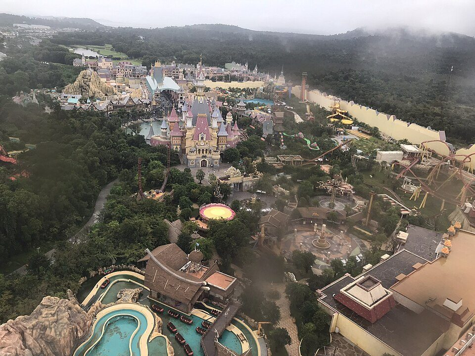

| | |
|---|---|
| **Where** | North-west, Bai Dai area |
| **Google rating** | **4.8** (17,816 reviews). Top-rated big attraction. |
| **Time needed** | 4–6 hours†. Combo tours for VinWonders plus the Safari run 8–10 hours. |
| **Hours** | A 2023 notice says 09:00–19:30. The official site lists 10:00–19:30. Ticket pages say many rides run roughly 13:00–19:00. |
| **Price** | 950,000 VND for guests 1.4 m and taller. Combo with the Safari about 1,500,000 VND (operator figures). |

**What people like:** Wanderlog's summary of Google reviews says the park felt **not crowded**, with **short queues** and quick entry. Reviewers praise the **water park**, the **Adventure World** zone and the **food**. Another source praises the aquarium and the **indoor areas** that give relief from the heat.
**What people complain about:** Some **ride closures**, and some found **water-park staff very strict**.
**Verdict:** The best-rated large paid attraction here. On Trip.com it scores a bit lower (4.5–4.6), so Google reviewers are a little kinder.
**Plan:** A common plan is the Safari in the morning, then VinWonders from early afternoon into the evening. A free Vinpearl bus is said to run between Duong Dong and both parks from 08:00 to 20:00, but one source says the ride takes about 50 minutes.

### 4. Grand World

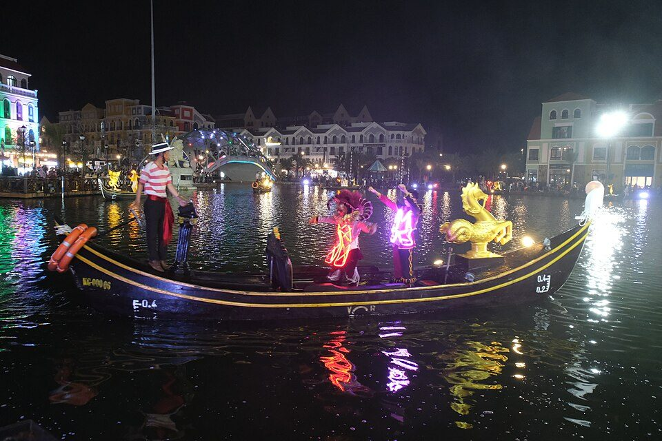

| | |
|---|---|
| **Where** | North-west, Bai Dai and Ganh Dau area |
| **Google rating** | **4.4** (12,620 reviews) |
| **Time needed** | 2–3 hours† in the evening |
| **Hours** | The Grand World night market is listed as 17:00 to 02:00. |

**What people like:** Canals ("Little Venice"), cafes, shops and nightly shows. It looks best after sunset.
**What people complain about:** I could not capture the review text. The lower score than the two Vin parks (4.4 against 4.6 and 4.8) suggests more mixed feelings, but I cannot say why.
**Verdict:** An evening walk and photo stop. Do not plan a full day here.

### 10. Starfish Beach (Rach Vem)

*No free-licensed photo found. [Find photos on Google Maps](https://www.google.com/maps/search/?api=1&query=Starfish+Beach+Phu+Quoc).*

| | |
|---|---|
| **Where** | North, Rach Vem village |
| **Google rating** | **3.8** (3,636 reviews) |
| **Time needed** | 45–90 minutes† on site, plus a long drive each way |
| **Best time** | **Low tide** (when the sea is at its lowest and starfish are easiest to see) |

**What people like:** Red starfish in clear shallow water, a calm setting, and seafood nearby.
**What people complain about:** The water is **shallow and not for swimming**. Reviewers saw **dead starfish** because tourists lift them out of the water. The road is **bumpy**. Some call it a **tourist trap with inflated prices**. Boat-ride offers are often not needed.
**Tip:** Look, but do not lift the starfish. Taking them out of the water kills them.
**Verdict:** A "look and go" stop. The 3.8 score fits that.

---

## West (Duong Dong and Long Beach)

### 7. Phu Quoc Night Market

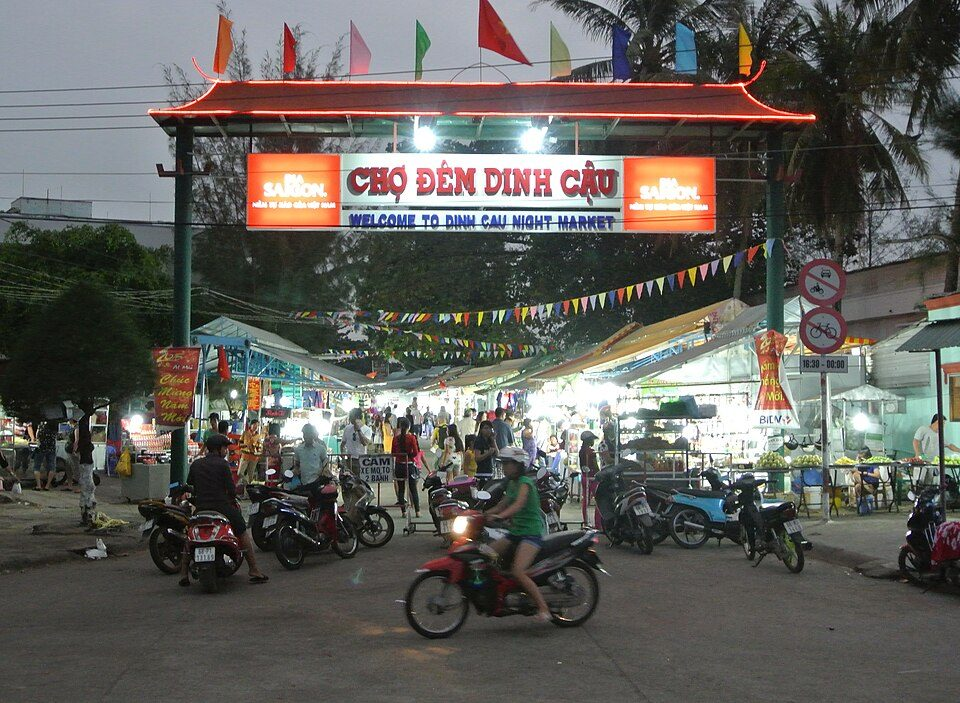

| | |
|---|---|
| **Where** | West, Duong Dong town, along Bach Dang Street near Dinh Cau |
| **Google rating** | **4.0** (6,575 reviews). Google has several listings, and the smaller ones score 3.8–3.9. |
| **Time needed** | 1–2 hours, with Dinh Cau nearby |
| **Hours** | Sources disagree: about 17:00–22:00, or 18:00–23:30. Closing time is not fixed. One guide suggests 18:30–21:00 as the best window. |

**What people like:** Lively. Good street food, snacks and seafood. Friendly shopkeepers.
**What people complain about:** **Touristy and pricey**, especially souvenirs and some food. Reviewers warn about **scams**, such as bait-and-switch sales and fake goods.
**Tips:** Eat cooked seafood unless you know what you are buying. Check the price before you order. Being dropped off or picked up a short walk away is easier than at the entrance.
**Verdict:** Go for the atmosphere and the food. Agree prices first.

### 9. Dinh Cau

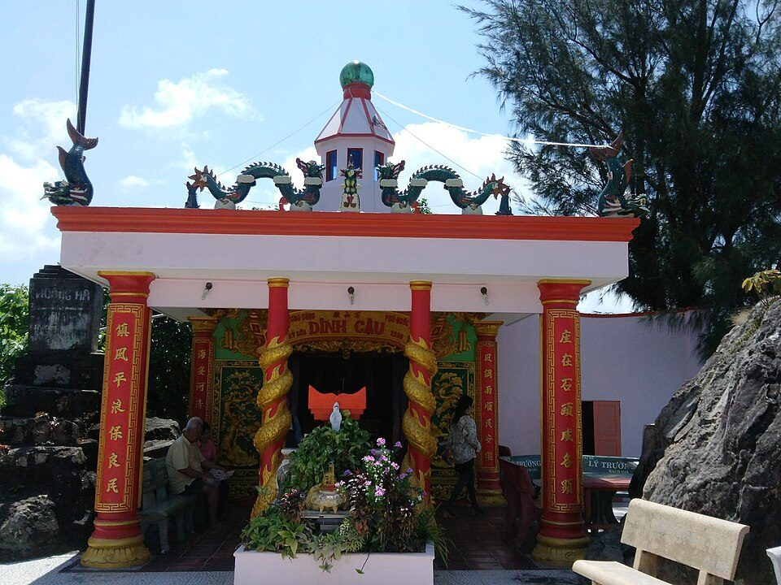

| | |
|---|---|
| **Where** | West, Duong Dong harbour, at the end of the night market street |
| **Google rating** | **4.5** (3,675 reviews) |
| **Time needed** | 20–30 minutes† on its own |

**What people like:** A small shrine to the **sea goddess**, with a **blue-and-white striped lighthouse** and harbour views. It is a short, easy stop and the reviews are consistently kind.
**Plan:** Combine it with the night market in one evening. A smaller temple next to it (Dinh Ba Thuy Long Thanh Mau) scores 4.5 (282).

### 8. Ngoc Hien Pearl Farm

*No free-licensed photo found. [Find photos on Google Maps](https://www.google.com/maps/search/?api=1&query=Ngoc+Hien+Pearl+Farm+Phu+Quoc).*

| | |
|---|---|
| **Where** | West, near Long Beach |
| **Google rating** | **4.2** (3,754 reviews) |
| **Time needed** | 30–60 minutes†. One guide says the farm offers free guided tours but gives no length. |

**Review text:** Not captured.
**My reading:** These are **demonstration plus shop** stops, so expect a sales pitch. This is my interpretation, not a quote from reviews. Phu Quoc is famous for pearls, fish sauce and pepper, so tours often bundle them.

### 11. Sunset Sanato

*No free-licensed photo found. [Find photos on Google Maps](https://www.google.com/maps/search/?api=1&query=Sunset+Sanato+Phu+Quoc).*

| | |
|---|---|
| **Where** | West coast, Long Beach area |
| **Google rating** | **4.0** (2,666 reviews). A nearby bar and restaurant listing scores 4.3 (2,229). |
| **Time needed** | 1.5–2 hours† for drinks and the sunset |

**What it is:** A beach club for sunset drinks, known for sunsets.
**Review text:** Not captured. Plan around the sunset time, and check prices before you sit down.

---

## South

### 2. Hon Thom cable car

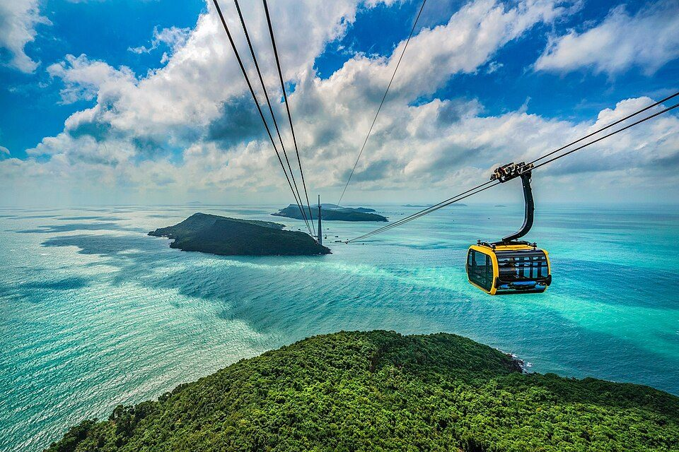

| | |
|---|---|
| **Where** | South, An Thoi station at the southern tip of the island |
| **Google rating** | **4.5** (19,408 reviews) |
| **Where it goes** | Over the sea and the An Thoi islands to **Hon Thom island** (Sun World Hon Thom). About 8 km of cable, around 150 m above the water. |
| **Time needed** | The ride itself is short. Expect **6–8 hours** for the whole Sun World Hon Thom visit. A half day (about 4 hours) means picking a few highlights. |
| **Hours** | Sources disagree. One gives about 09:00–11:30 and 13:30–17:00, with a midday break. Another gives different afternoon times. Check the timetable at the station. |

**What people like:** Views over the sea and islands. It is billed as one of the longest over-sea cable cars in the world (a claim from promotional sources).
**What people complain about:** The **return trip can be crowded and chaotic**. One blogger (a 2019 visit) found the beach areas on Hon Thom **restricted by guards**, and had mixed feelings about the environmental impact.
**Tickets:** One source says the cable car is **not sold alone**. A round-trip ticket gets you into Sun World Hon Thom, including Aquatopia. A free shuttle runs to the An Thoi station. I did not find a price, so check the official Sun World site.
**Tip:** Do not go for the beach. The "Pineapple beach" listing on Hon Thom scores only 2.9 (51 reviews).

### 13. Sun World Hon Thom Nature Park + Aquatopia

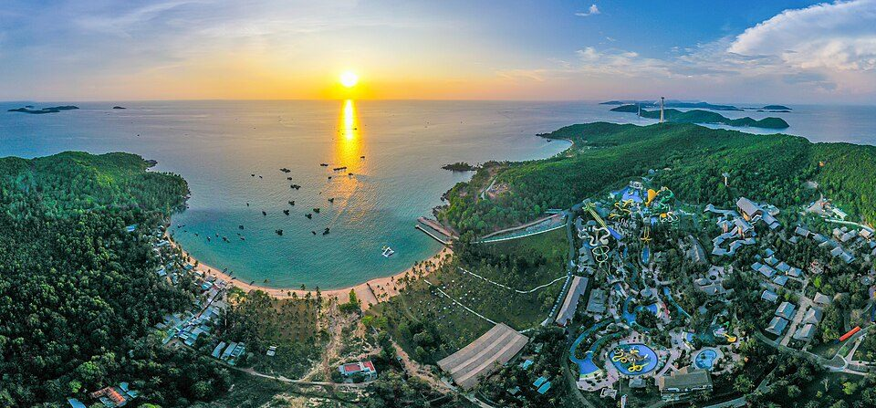
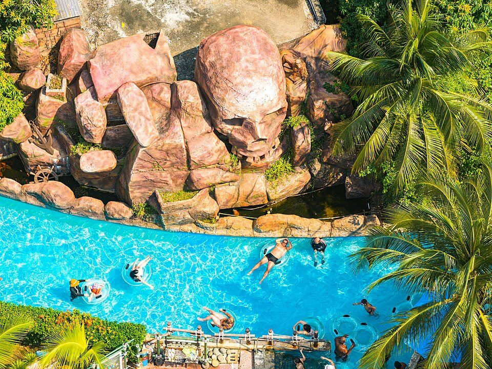

| | |
|---|---|
| **Where** | Hon Thom island, off the south tip. You arrive by the cable car. |
| **Rating** | **4.7** on Trip.com (about 215 reviews). No Google count found. |
| **Time needed** | 4–6 hours† for the park and water park. The whole Sun World day is 6–8 hours. |
| **Hours** | One listing gives Aquatopia 10:00–16:45 and Exotica Park 09:30–16:45. Confirm before you go. |

**What it is:** An adventure park with 30+ interactive games and rides, plus the **Aquatopia water park** with slides and splash zones. A round-trip cable car ticket includes Aquatopia.
**Review text:** Not captured. The Trip.com score is high but based on few reviews, so it is a weak signal.
**Tip:** Start early. The parks close in the afternoon, and the cable car has a midday break.

### 5. Phu Quoc Prison (Coconut Tree Prison)

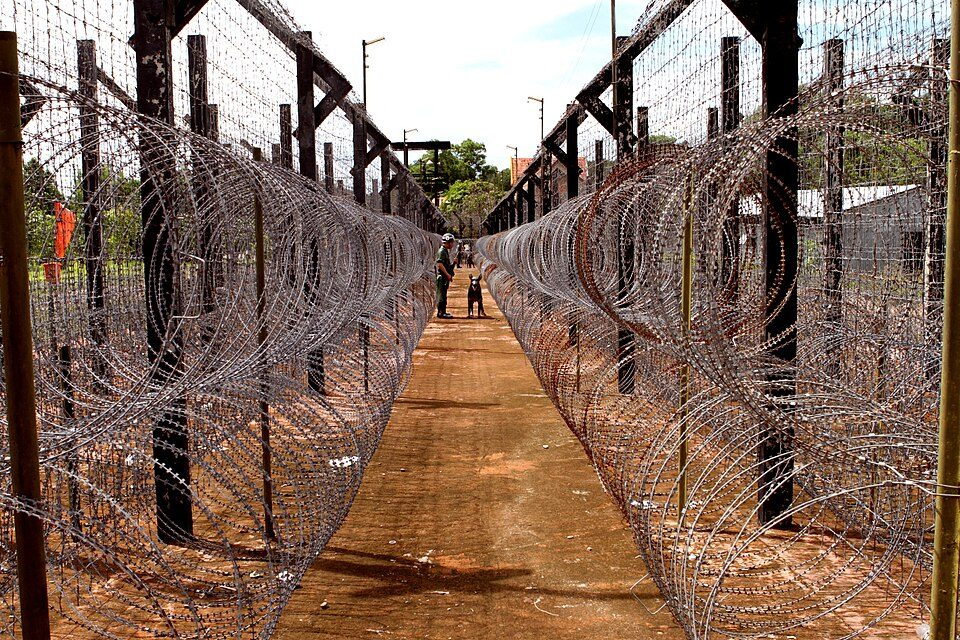

| | |
|---|---|
| **Where** | South, An Thoi |
| **Google rating** | **4.3** (9,412 reviews) |
| **Time needed** | 1–2 hours (Vinpearl). Other guides say 30–60 minutes, and one tour operator lists 45 minutes. |
| **Hours** | Most sources: about 08:30–11:30 and 13:30–17:00, with a **midday break**. One outlier says 07:00–17:00. Guides are not available at lunchtime. |
| **Price** | Free, in every source |

**Star breakdown (9,412 reviews):**

| Stars | Reviews | Share |
|---|---|---|
| 5 | 5,449 | 58% |
| 4 | 2,110 | 22% |
| 3 | 1,214 | 13% |
| 2 | 289 | 3% |
| 1 | 350 | 4% |

**What people like:** "Deeply moving and thought-provoking." Detailed reconstructions, photos and stories. Translated signs.
**What people complain about:** The page gave no reasons for the 639 one- and two-star reviews. Blogs say the site has been **heavily rebuilt**, so little looks original, and the content is **graphic** (reconstructed cells and "tiger cages"). It is also **hot and sunny**, so bring an umbrella or cap and water.
**Verdict:** A strong history stop. Not for small children, or for anyone who wants a light day.

### 6. Sao Beach

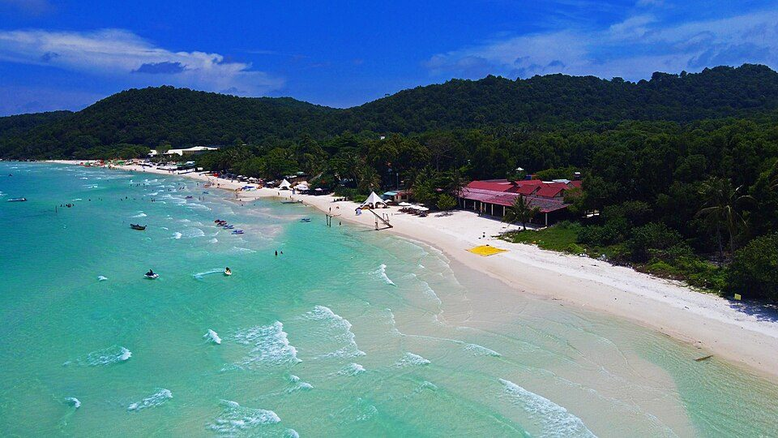

| | |
|---|---|
| **Where** | South-east |
| **Google rating** | **3.9** (8,202 reviews). Tripadvisor: 3.4 from 4,216 reviews. |
| **Time needed** | 1–3 hours†. It is about a 25-minute drive from Duong Dong. |

**What people like:** **White sand and clear water**, sun beds and water activities.
**What people complain about:** **Litter and pollution** is the top complaint. One Google reviewer said there was "an enormous amount of ocean trash everywhere" and left for Khem Beach. Beach clubs only clean their own patch. **Jet-ski noise.** **Sun beds cost about 100,000–150,000 VND**, even if you buy a drink. Toilets and showers may cost extra.
**Verdict:** The photos are better than the reality. Go early and bring a towel. Consider Khem Beach instead.

### 12. Khem Beach

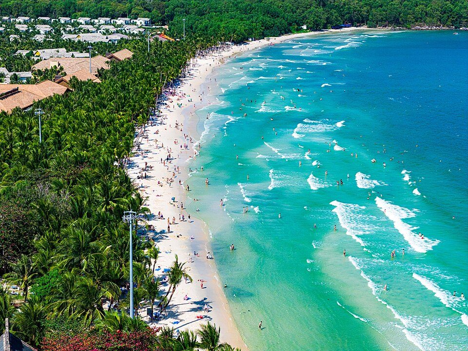

| | |
|---|---|
| **Where** | South |
| **Google rating** | **4.4** (2,109 reviews) |
| **Time needed** | 1–2 hours† |

**What people like:** One guide says it is "probably the quietest" beach on the island. A Sao Beach reviewer switched to it because it was cleaner.
**Verdict:** A good score on a solid number of reviews. Pair it with Sao Beach or the prison for a south-east morning.

---

## Suggested day plans

These plans are mine. They use the times above and group places by area so you do not cross the island more than once a day.

| Day | Plan | Rough total |
|---|---|---|
| **North-west day** | Vinpearl Safari in the morning, VinWonders from early afternoon. Grand World after dark if you still have energy. | 9–10 hours for the two parks |
| **South day (cable car)** | Cable car to Hon Thom, then the park and Aquatopia. Come back before it gets late. | 6–8 hours |
| **South day (history and beaches)** | Phu Quoc Prison in the morning, before the midday break. Then Khem Beach and Sao Beach. | 4–6 hours† |
| **Duong Dong evening** | Pearl farm in the afternoon, sunset at Sunset Sanato, then Dinh Cau and the night market. | 5–6 hours† |
| **Optional north trip** | Starfish Beach at low tide. It is far from the other places, so combine it with the north-west day only if you have time. | 1–1.5 hours† plus driving |

---

## Things to understand before you go

1. **Season.** The dry season is roughly **November to April**. The wet season is roughly **May to October**, with the wettest stretch usually June to September. Mid-October is a **transition month**, so expect some rain and a rougher sea. Boat and outdoor plans are less predictable in the wet season. Sources gave no cancellation rates, so ask operators about weather policies.
2. **Plan by area.** The north-west (Vin parks, Grand World) and the south (cable car, prison, Sao and Khem beaches) are about an hour apart. Sunset Town is 40–45 minutes from Duong Dong, about 19–20 km from the airport.
3. **Timing traps.** The cable car and the prison both have a **midday break**. The Safari stops letting people in around 15:00. Arriving at the wrong time can cost you an hour or more.
4. **Prices (operator figures, may be out of date).** VinWonders 950,000 VND, Vinpearl Safari 850,000 VND, combo about 1,500,000 VND (guests 1.4 m and taller). The prison is free. 1,000,000 VND is very roughly 40 USD, but check today's rate. Check the official site before paying a reseller.
5. **Visa.** Travel-agency and tourism-site guides say visitors can stay **up to 30 days without a visa** on Phu Quoc if they fly **directly** to the island. This covers the island only. These are not government sources, so confirm with official Vietnamese immigration or embassy pages. See the [Vietnam tourism visa explainer](https://www.vietnamtourism.com/en/phu-quoc-visa-free-entry-how-the-30-day-exemption-works-and-who-qualifies).
6. **Beaches.** Expect litter at some, especially Sao Beach. A 2019 blogger also found some beaches closed off by resorts. That was a few years ago, so check locally.
7. **Money and scams.** Several sources warn about higher prices at the night market and tourist spots, bait-and-switch sales and fake goods. Agree the price first, for food, rides and sun beds.
8. **Heat.** Daytime temperatures are around 30–33 °C. One blogger found riding a scooter at midday (about 35 °C) exhausting. Plan outdoor sights early or late.
9. **Respect the starfish.** Do not lift them out of the water at Rach Vem.
10. **Data quirks.** Some places have several Google listings (the night market has at least three). Some listings are mislabelled. Check the live Google Maps pin before you go. Google listings say either "Kien Giang" or "An Giang" for Phu Quoc, because the island was moved into An Giang province. It is the same island.

---

## Photo credits

Photos come from [Wikimedia Commons](https://commons.wikimedia.org/) under the free licences shown. I resized each one and did not change them otherwise. CC BY-SA licences ask you to credit the photographer and keep the same licence if you share them. There is no free photo for Starfish Beach, Ngoc Hien Pearl Farm and Sunset Sanato, so those entries link to Google Maps.

| Place | Photo and photographer | Licence |
|---|---|---|
| Vinpearl Safari | [The Herd of Rhinos.jpg](https://commons.wikimedia.org/wiki/File:The_Herd_of_Rhinos.jpg) by Aidashhk | [CC0](https://creativecommons.org/publicdomain/zero/1.0/) |
| VinWonders | [VinWonders Phu Quoc from ferris wheel.jpg](https://commons.wikimedia.org/wiki/File:VinWonders_Phu_Quoc_from_ferris_wheel.jpg) by lol1VNIO | [CC BY-SA 4.0](https://creativecommons.org/licenses/by-sa/4.0/) |
| Grand World | [2023-07-30 Grand World Phú Quốc DSCF2045.jpg](https://commons.wikimedia.org/wiki/File:2023-07-30_Grand_World_Ph%C3%BA_Qu%E1%BB%91c_DSCF2045.jpg) by 松岡明芳 | [CC BY-SA 4.0](https://creativecommons.org/licenses/by-sa/4.0/) |
| Phu Quoc Night Market | [Night market in Phu Quoc.jpg](https://commons.wikimedia.org/wiki/File:Night_market_in_Phu_Quoc.jpg) by Tonbi ko | [CC BY-SA 4.0](https://creativecommons.org/licenses/by-sa/4.0/) |
| Dinh Cau | [Dinh Cậu Phú Quốc.jpg](https://commons.wikimedia.org/wiki/File:Dinh_C%E1%BA%ADu_Ph%C3%BA_Qu%E1%BB%91c.jpg) by Hoangvantoanajc | [CC BY-SA 3.0](https://creativecommons.org/licenses/by-sa/3.0/) |
| Hon Thom cable car | [Hon Thom Cable Car aerial view Phu Quoc Island Vietnam.jpg](https://commons.wikimedia.org/wiki/File:Hon_Thom_Cable_Car_aerial_view_Phu_Quoc_Island_Vietnam.jpg) by Vivu Vietnam | [CC BY-SA 4.0](https://creativecommons.org/licenses/by-sa/4.0/) |
| Sun World Hon Thom | [Sun World Hon Thom aerial view panorama sunset Phu Quoc.jpg](https://commons.wikimedia.org/wiki/File:Sun_World_Hon_Thom_aerial_view_panorama_sunset_Phu_Quoc.jpg) by Vivu Vietnam | [CC BY-SA 4.0](https://creativecommons.org/licenses/by-sa/4.0/) |
| Aquatopia | [Cong-vien-nuoc-aquatopia-5.jpg](https://commons.wikimedia.org/wiki/File:Cong-vien-nuoc-aquatopia-5.jpg) by Vivu Vietnam | [CC BY-SA 4.0](https://creativecommons.org/licenses/by-sa/4.0/) |
| Phu Quoc Prison | [Phu Quoc Prison.jpg](https://commons.wikimedia.org/wiki/File:Phu_Quoc_Prison.jpg) by Frank Fox | [CC BY-SA 4.0](https://creativecommons.org/licenses/by-sa/4.0/) |
| Sao Beach | [Bai-sao-phu-quoc-tuonglamphotos.jpg](https://commons.wikimedia.org/wiki/File:Bai-sao-phu-quoc-tuonglamphotos.jpg) by Trantuonglam | [CC BY-SA 4.0](https://creativecommons.org/licenses/by-sa/4.0/) |
| Khem Beach | [Bai-kem-dong-khach-1.jpg](https://commons.wikimedia.org/wiki/File:Bai-kem-dong-khach-1.jpg) by Vivu Vietnam | [CC BY-SA 4.0](https://creativecommons.org/licenses/by-sa/4.0/) |

---

## What I could not confirm

- A Google rating and review count for **Sun World Hon Thom Nature Park + Aquatopia**.
- Detailed Google review text for **Grand World**, **Ngoc Hien Pearl Farm** and **Sunset Sanato**.
- Real queue lengths at the cable car and parks.
- Exact ticket prices for the cable car and Sun World Hon Thom.
- Source-backed visit times for Grand World, the beaches, Dinh Cau, the pearl farm and Sunset Sanato. Those are my estimates (marked †).

---

## Sources

Ratings and review counts (Google data, shown on Wanderlog):
- [Wanderlog: best beaches in and around Phu Quoc](https://wanderlog.com/list/geoCategory/1498204/best-beaches-in-and-around-phu-quoc-island)
- [Wanderlog: Duong Dong things to do](https://wanderlog.com/list/geoCategory/1586781/top-things-to-do-and-attractions-in-duong-dong)
- [Wanderlog: Phu Quoc in November](https://wanderlog.com/geoInMonth/202/11/phu-quoc-island-in-november)
- [Wanderlog: Phu Quoc Prison History Museum](https://wanderlog.com/place/details/756754/phu-quoc-prison-history-museum)
- [Wanderlog: Sao Beach](https://wanderlog.com/place/details/30709/sao-beach)
- [Wanderlog: VinWonders Phu Quoc](https://wanderlog.com/place/details/2175961/vinwonders-phú-quốc)
- [Wanderlog: Starfish Beach](https://wanderlog.com/place/details/118316/starfish-beach)
- [Trip.com: best things to do in Phu Quoc](https://sa.trip.com/toplist/tripbest/phu-quoc-island-best-things-to-do-100000015137) (Hon Thom Nature Park rating)

Visit times, hours and tips:
- [Vinpearl: Phu Quoc Prison guide](https://vinpearl.com/en/phu-quoc-prison)
- [Rolling Grace: Phu Quoc Prison](https://rollinggrace.com/2026/03/12/phu-quoc-prison/)
- [Sun Paradise Land: how many hours are enough for Sun World Hon Thom](https://sunparadiseland.com/en/SunParadiseLandPhuQuoc/tin-tuc/how-many-hours-are-enough-for-sun-world-hon-thom-suggested-detailed-itinerary-24363)
- [Visit Phu Quoc: guide to Sun World Hon Thom](https://visitphuquoc.com.vn/en/most-detailed-guide-to-travel-to-sun-world-hon-thom-5671)
- [Visit Phu Quoc: Hon Thom cable car tickets and tips](https://visitphuquoc.com.vn/en/whats-at-the-worlds-longest-hon-thom-cable-car-ticket-prices-and-tips-9831)
- [Visit Phu Quoc: Sunset Town review](https://visitphuquoc.com.vn/en/detailed-exploration-review-of-sunset-town-phu-quoc-from-a-to-z-9712)
- [VinWonders: guide to VinWonders and Vinpearl Safari](https://vinwonders.com/vi/wonderpedia/news/kinh-nghiem-di-vinwonders-va-vinpearl-safari-phu-quoc-chi-tiet/)
- [VinWonders: Vinpearl Safari itinerary](https://vinwonders.com/en/wonderpedia/news/vinpearl-safari-phu-quoc-itinerary-with-kids/)
- [TRVLogue: VinWonders and Safari tickets](https://www.trvlogue.com/en/vinwonders-phu-quoc-tickets)
- [Local Vietnam: Phu Quoc Night Market guide](https://localvietnam.com/phu-quoc/phu-quoc-night-market/)
- [Local Vietnam: Starfish Beach guide](https://localvietnam.com/phu-quoc/starfish-beach-rach-vem-phu-quoc/)
- [Local Vietnam: best time to visit Phu Quoc](https://localvietnam.com/phu-quoc/best-time-to-visit-phu-quoc/)
- [Vietnam Airlines: how many days in Phu Quoc](https://www.vietnamairlines.com/en/useful-information/travel-guide/how-many-days-in-phu-quoc)
- [Dave's Travel Pages: honest take on Phu Quoc](https://www.davestravelpages.com/lets-be-honest-about-phu-quoc-in-vietnam/) (a 2019 visit, so older)
